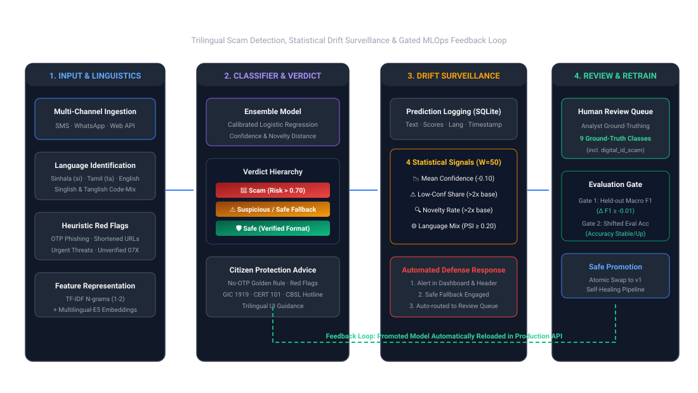

# ScamRadar LK

**Multilingual scam detection that notices when scammers change tactics.**

ScamRadar LK checks SMS and WhatsApp messages written in Sinhala, Tamil, Singlish, Tanglish, English or a mix,
labels them **Scam**, **Suspicious** or **Safe** with plain-language warning signs, and watches its own predictions
for drift. When a new scam wave appears, it raises an alert, never marks an unfamiliar message as safe, routes it to
human review, and retrains with the reviewed labels, promoting the new model only if it passes an evaluation gate.

> TensorForge 2.0 Final-Forge · Theme: Scam-Proof by Design · Team Paradox · built on 17 October 2026 within the
> 6-hour window, from an empty repository.

| Held-out result (600 messages) | Score |
| --- | --- |
| Accuracy | **0.965** |
| Macro-F1 | **0.971** |
| Scam recall | **1.00** |
| False alarm rate (legit messages flagged) | **0.077** |
| Sinhala · Tamil · Singlish · Tanglish · mixed | **1.00** each (English 0.867) |

---

## 1. Problem and users

In June 2026 the Central Bank of Sri Lanka launched the nationwide *Be Scam Proof* campaign, warning that digital
fraud is becoming more sophisticated and adaptive. Scam messages in Sri Lanka arrive in several scripts and in
romanised Sinhala and Tamil, and their wording changes quickly. New public systems such as the planned national
digital ID (**SL-UDI**) create new impersonation targets. A detector that is accurate on launch day can fail weeks
later without anyone noticing.

**Who we protect**

| Group | Why they are at risk |
| --- | --- |
| First-time mobile-banking users | Fake bank alerts that ask for OTPs, PINs or logins |
| Elderly people and welfare recipients (Aswesuma, pensions) | Fake "your payment is pending" messages; Aswesuma had **1,251,522** beneficiaries in August 2026 |
| Job and loan seekers | Fake job registration fees and instant-loan "insurance fees" |

**Scam types detected:** `bank_impersonation`, `fake_prize`, `parcel_fee`, `fake_job`, `investment_scheme`,
`loan_app`, `welfare_scam`, plus `legit` for normal messages. `digital_id_scam` (SL-UDI) is the **new tactic** used
only in the shifted data. Definitions: [`ml/LABELS.md`](ml/LABELS.md).

The one-page impact statement is in [`docs/IMPACT_STATEMENT.md`](docs/IMPACT_STATEMENT.md).

---

## 2. Architecture



What happens to one message:

1. The **React dashboard** sends the text to `POST /api/check`.
2. **Language detection and red flags** (`backend/app/textutils.py`): language form (`si`, `ta`, `mixed`, `en`,
   `singlish`, `tanglish`) and seven warning signs: link, OTP/PIN request, urgency, money request, prize, account
   threat, unknown phone number.
3. **Classifier v1** (`backend/app/model.py`): TF-IDF + Logistic Regression blended with a classifier on frozen
   `multilingual-e5-small` embeddings, using separate blend weights for native script, English and romanised text
   (language-aware ensemble).
4. **Verdict with a safe fallback:** Scam, Suspicious or Safe. If confidence is below 0.55 or the message is far
   from the training data, the verdict is never Safe: it becomes Suspicious with "verify through the official
   hotline" advice and goes to the review queue.
5. **Prediction log** (SQLite): time, language, verdict, scam type, risk, confidence, novelty, model version.
6. **Drift monitor** (`backend/app/drift.py`): the last 50 predictions are compared with the held-out baseline.
7. **Drift response:** alert banner and alert log, human review queue, gated retraining, model versioning.

| Component | Technology | Location |
| --- | --- | --- |
| API | FastAPI + Uvicorn | `backend/app/main.py` |
| Model | scikit-learn, sentence-transformers (`intfloat/multilingual-e5-small`) | `ml/`, `backend/app/model.py` |
| Logging, alerts, reviews | SQLite | `backend/app/db.py` |
| Drift monitor | Python | `backend/app/drift.py` |
| Frontend | React + Vite | `frontend/` |
| Container | Docker (CPU-only torch, model baked in) | `Dockerfile` |

---

## 3. How to run it

### Option A: Python (documented commands)

```bash
python -m venv .venv
source .venv/bin/activate            # Windows: .venv\Scripts\activate
pip install -r requirements.txt

python -m ml.make_data               # writes data/processed/{train,test,shifted,shifted_eval}.csv
python -m ml.train --v1              # trains, evaluates, writes models/model.joblib and reports/metrics.json
uvicorn backend.app.main:app --host 0.0.0.0 --port 8000
```

Open `http://localhost:8000/docs` for the interactive API. The trained model (`models/model.joblib`) is already in the
repository, so the training step is optional. The e5-small model downloads from Hugging Face on first use; to load it
from a local folder instead, set `E5_MODEL` (Linux/macOS `export E5_MODEL=/path/to/e5-small`, PowerShell
`$env:E5_MODEL = "C:\path\to\e5-small"`).

### Option B: Docker (preferred)

```bash
docker build -t scamradar .
docker run -p 8000:8000 scamradar
```

The image installs CPU-only PyTorch and bakes `multilingual-e5-small` into the image at build time, so the container
runs without internet access (checked with `docker run --network none`).

### Frontend

```bash
cd frontend
npm install
echo "VITE_API_URL=http://localhost:8000" > .env.local
npm run dev                           # http://localhost:5173
```

Pages: **Check Message**, **Drift Monitor** (signal cards, confidence/novelty chart, simulate buttons) and
**Review Queue** (labelling, gated retraining, gate log), with a drift alert banner.

### Drift demo in 5 steps

1. `POST /api/admin/reset-log` (clear the log).
2. Drift Monitor → **Simulate Normal Traffic** (`test.csv`) → all signals healthy.
3. **Simulate New Scam Wave** (`shifted.csv`, SL-UDI) → drift alert, fallback active.
4. Review Queue → label the SL-UDI messages `digital_id_scam` → **Trigger Gated Retrain**.
5. Simulate the wave again → accuracy on the new tactic rises.

---

## 4. Data sources and licences

No dataset was provided, so all data was generated during the build window with no real personal data.

| File | Rows | How it was made | Licence |
| --- | --- | --- | --- |
| `data/processed/train.csv` | 3,000 | `ml/make_data.py`: hand-written phrase banks in six language forms (Sinhala, Tamil, Singlish, Tanglish, English, mixed), combined by templates; extra legit messages | Own work, MIT |
| `data/processed/test.csv` | 600 | Same generator, **different phrase combinations** from train (held-out; 0 texts overlap with train) | Own work, MIT |
| `data/processed/shifted.csv` | 300 | New tactic: SL-UDI digital ID scams, more Tanglish, obfuscated links (`b1t.ly`, `l0gin`, `sl-ud1-verify`); used in the live drift demo and the review queue | Own work, MIT |
| `data/processed/shifted_eval.csv` | 100 | Same wave, a separate set that is **never reviewed**; used only by the retraining gate | Own work, MIT |
| `intfloat/multilingual-e5-small` | – | Public pretrained embedding model from Hugging Face, used frozen (not fine-tuned) | MIT |

Columns: `text, label, language, channel`. Phrase writing was assisted by an LLM (see AI tools).

**Privacy (Personal Data Protection Act, No. 9 of 2022 principles):** no real phone numbers (masked as
`07X-XXX-XXXX`), no NIC or account numbers, no screenshots, fictional bank and courier names (for example
"Lanka Pragathi Bank", "SpeedLanka Express"). Synthetic scam messages are for training and testing only and are never
sent to anyone.

---

## 5. Evaluation results (held-out test set)

Scored on `test.csv` (600 messages, never seen in training). Blend weights are tuned on a 15% split of the training
data, never on the test set. Source: [`reports/metrics.json`](reports/metrics.json),
history: [`reports/history.jsonl`](reports/history.jsonl).

| Version | Model | Accuracy | Macro-F1 | Scam recall | False alarm rate |
| --- | --- | --- | --- | --- | --- |
| v0 | TF-IDF (word + character n-grams) + Logistic Regression | 0.887 | 0.911 | 1.00 | 0.249 |
| v0 + data | v0 with more varied legit messages in train | 0.933 | 0.951 | 1.00 | 0.147 |
| **v1 (shipped)** | **TF-IDF + multilingual-e5-small, language-aware ensemble** | **0.965** | **0.971** | **1.00** | **0.077** |

v1 accuracy by language: Sinhala 1.00 · Tamil 1.00 · mixed 1.00 · Singlish 1.00 · Tanglish 1.00 · English 0.867.

**On the shifted SL-UDI set** (`shifted_eval.csv`, 100 messages) before retraining: accuracy **0.13** (the scam type
is new to the model), but scam recall **0.957**: almost all are still flagged as scams, only the type is wrong. This
is the drift the monitor must catch.

**Lesson:** v1 first scored the same as v0. The bottleneck was the data (too few varied legit messages), not the
model; adding legit messages cut false alarms from 0.249 to 0.077.

---

## 6. Monitoring and drift response

### Prediction logging

Every call to `/api/check` and `/api/simulate` is stored in SQLite (`runtime/scamradar.db`) with timestamp, channel,
language, verdict, scam type, risk, confidence, novelty and model version, and is written to the server log.

### Drift signals (window: last 50 predictions, baseline: held-out test set)

| Signal | Fires when |
| --- | --- |
| Mean confidence | It falls more than 0.10 below the baseline |
| Low-confidence share (confidence < 0.55) | It is above 10% and more than twice the baseline |
| Novelty rate (embedding distance to the nearest training message above the test set's 95th percentile) | It is above 10% and more than twice the baseline |
| Language mix (PSI, add-one smoothed) | It is above 0.25 |

Add-one smoothing on the language PSI cut false alarms on normal traffic from about 14% of windows to about 1%.

### Live demo results (v1)

| Signal | Normal traffic | SL-UDI wave | Baseline |
| --- | --- | --- | --- |
| Mean confidence | 0.86 · ok | **0.54 · alert** | 0.87 |
| Low-confidence share | 0.10 · ok | **0.68 · alert** | 0.11 |
| Novelty rate | 0.04 · ok | 0.02 · ok | 0.05 |
| Language PSI | 0.03 · ok | 0.22 · ok | 0.00 |
| **Drift** | **no (0 alerts)** | **yes** | |

The novelty signal stays quiet because the SL-UDI wave reuses familiar scam semantics (links, OTP requests, threats),
which is also why 95.7% of it is still flagged as scam. What changes is the model's certainty about the scam type,
and both confidence signals catch that. Thresholds were not tuned for the demo.

### Drift response

1. **Alert:** a dashboard banner ("Drift detected · fallback active") and an `alerts` table (`GET /api/alerts`).
2. **Safe fallback:** unfamiliar or low-confidence messages are never marked Safe; they become Suspicious with
   "verify through the official hotline" advice.
3. **Human review queue:** those messages appear in `GET /api/review`; an analyst labels them with
   `POST /api/review/{id}`.
4. **Gated retraining:** `POST /api/retrain` retrains with the reviewed labels in the background. The new model is
   promoted only if held-out macro-F1 does not drop by more than 0.01 **and** accuracy on `shifted_eval.csv` does not
   fall; otherwise the previous model is kept and the result is written to `reports/gate_rejected.json`. Every
   promoted model gets a new version and a line in `reports/history.jsonl`.

---

## 7. API

Full request and response examples: [`docs/API.md`](docs/API.md).

| Endpoint | Purpose |
| --- | --- |
| `GET /health` | Status and active model version |
| `POST /api/check` | Check one message: verdict, scam type, risk, confidence, novelty, red flags, advice |
| `GET /api/monitor` | Drift signals, baseline, drift flag and response text |
| `GET /api/monitor/history` | Recent predictions for charts |
| `GET /api/alerts` | Alert history |
| `GET /api/review` · `POST /api/review/{id}` | Review queue and human labels |
| `POST /api/simulate` | Replay `test` or `shifted` data through the live model (drift demo) |
| `POST /api/retrain` · `GET /api/retrain` | Start gated retraining and read its status and log |
| `POST /api/admin/reset-log` | Clear predictions and alerts before a demo |

---

## 8. Repository structure

```
backend/app/      FastAPI app: main.py, model.py, drift.py, db.py, textutils.py
ml/               make_data.py (data), train.py (training + evaluation + gate), embed.py (e5), LABELS.md
data/processed/   train, test, shifted, shifted_eval CSVs
models/           model.joblib (trained bundle)
reports/          metrics.json, history.jsonl
frontend/         React + Vite dashboard
docs/             API.md, IMPACT_STATEMENT.md, ANALYTICS.md, architecture.svg
Dockerfile        CPU-only container with the embedding model baked in
requirements.txt  pinned Python dependencies
```

---

## 9. Limitations and next steps

- The data is synthetic; scores show performance on our generator's held-out set, not on real traffic. Next: real,
  consented reported scams with a bank or CERT partner, and native-speaker review of Sinhala and Tamil text.
- English accuracy (0.867) is the lowest; more varied English legit messages are the first fix.
- A 7.7% false-alarm rate is acceptable for a warning tool (Suspicious means "verify"), but should fall with real data.
- Next product steps: an SMS / WhatsApp forwarding bot, and a pilot with a bank's customer-awareness channel or
  Divisional Secretariat welfare officers using the review queue.

---

## 10. AI tools used

- **Claude (Anthropic)** as a coding and writing assistant (scaffold, training and drift code, documentation).
- **LLM-assisted writing** of synthetic message phrases for the data generator.
- Every team member can explain the code.

**Templates reused:** none; all code was written during the build window.

---

## 11. Team Paradox

| Member | Role |
| --- | --- |
| Kaveesha Madhushan | ML: data generator, models, evaluation, language-aware ensemble |
| Hiyumi (dilmani773) | Backend / MLOps: API, logging, drift monitor, Docker, live server |
| Didulana Lokugamage | Frontend: Check, Drift Monitor and Review Queue UI |
| Hareen Liyanage | Analytics and docs: review analytics, alert banner, impact statement, pitch deck |

## Licence

[MIT](LICENSE)
