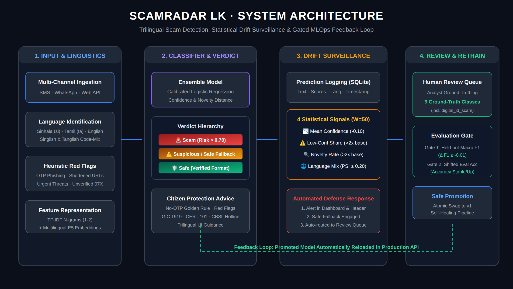

# ScamRadar LK

**A scam checker for Sri Lanka that notices when scammers change their tricks.**

ScamRadar LK checks SMS and WhatsApp messages. It works in Sinhala, Tamil, Singlish, Tanglish and English. It says Scam, Suspicious or Safe. It shows the warning signs in simple words. It also watches its own answers. When a new scam wave arrives, it raises an alert. It never marks an unfamiliar message as Safe. It sends that message to a human reviewer. Then it learns from the reviewed messages. A new model goes live only if it passes a test.

TensorForge 2.0 Final Forge. Theme: Scam Proof by Design. Team Paradox. Built on 17 October 2026 in the 6 hour window. We started from an empty repository.

**Results on the held out test set (600 messages)**

* Accuracy: **0.965**
* Macro F1: **0.971**
* Scam recall: **1.00** (it caught every scam)
* False alarm rate: **0.077** (normal messages marked as scam or suspicious)
* Sinhala, Tamil, Singlish, Tanglish and mixed text: **1.00** each. English: 0.867.
* New SL-UDI scam wave: **0.13** before retraining. **0.98** after retraining.


## 1. The problem and the users

In June 2026 the Central Bank of Sri Lanka started the *Be Scam Proof* campaign. Digital fraud is growing. Scam messages come in many scripts. Many are written in Sinhala or Tamil with English letters. Scammers change their words often. New systems like the SL-UDI digital ID give them new targets. A scam filter can work well today and fail next month. Often nobody notices.

**Who we protect**

* **First time mobile banking users.** They get fake bank alerts. These ask for an OTP, a PIN or a login.
* **Elderly people and welfare recipients.** They get fake "your payment is pending" messages. Aswesuma had **1,251,522** beneficiaries in August 2026.
* **Job and loan seekers.** They get fake job fees and fake loan app fees.

**Scam types we detect:** `bank_impersonation`, `fake_prize`, `parcel_fee`, `fake_job`, `investment_scheme`, `loan_app`, `welfare_scam`. Normal messages are `legit`. The new tactic is `digital_id_scam` (SL-UDI). It appears only in the shifted data. See [`ml/LABELS.md`](ml/LABELS.md).

The one page impact statement is in [`docs/IMPACT_STATEMENT.md`](docs/IMPACT_STATEMENT.md).


## 2. How it works



What happens to one message:

1. The **React app** sends the message to `POST /api/check`.
2. The system **finds the language**. It can be `si`, `ta`, `mixed`, `en`, `singlish` or `tanglish`. It checks **7 warning signs**: a link, an OTP or PIN request, urgency, a money request, a prize, an account threat and an unknown phone number. Code: `backend/app/textutils.py`.
3. **Model v1** gives a score. It mixes two models. One uses TF-IDF word and letter patterns. The other uses frozen `multilingual-e5-small` embeddings. Each language group (native script, English, romanised) has its own mix weight. Code: `backend/app/model.py`.
4. **Verdict with a safe fallback.** The answer is Scam, Suspicious or Safe. If confidence is below 0.55, or the message is far from the training data, the answer is never Safe. It becomes Suspicious. The advice says "verify through the official hotline". The message goes to the review queue.
5. **Prediction log.** Every check is saved in SQLite. We save the time, language, verdict, scam type, risk, confidence, novelty and model version.
6. **Drift monitor.** It compares the last 50 checks with the held out baseline. Code: `backend/app/drift.py`.
7. **Drift response.** An alert banner and an alert log. A human review queue. Retraining with a gate. A new version number for every new model.

**Parts of the system**

* API: FastAPI and Uvicorn. File: `backend/app/main.py`.
* Model: scikit-learn and sentence-transformers (`intfloat/multilingual-e5-small`). Folders: `ml/` and `backend/app/model.py`.
* Logs, alerts and reviews: SQLite. File: `backend/app/db.py`.
* Drift monitor: Python. File: `backend/app/drift.py`.
* Frontend: React and Vite. Folder: `frontend/`.
* Container: Docker with CPU only PyTorch. The embedding model is inside the image. File: `Dockerfile`.


## 3. How to run it

### Option A: Python

```bash
python -m venv .venv
source .venv/bin/activate            # Windows: .venv\Scripts\activate
pip install -r requirements.txt

python -m ml.make_data               # makes data/processed/{train,test,shifted,shifted_eval}.csv
python -m ml.train --v1              # trains, tests, saves models/model.joblib and reports/metrics.json
uvicorn backend.app.main:app --host 0.0.0.0 --port 8000
```

Open `http://localhost:8000/docs` to try the API. The trained model is already in the repository. So the training step is optional. The e5 model downloads from Hugging Face the first time. To use a local copy, set `E5_MODEL`. On Linux or macOS: `export E5_MODEL=/path/to/e5-small`. In PowerShell: `$env:E5_MODEL = "C:\path\to\e5-small"`.

### Option B: Docker (best)

```bash
docker build -t scamradar .
docker run -p 8000:8000 scamradar
```

The image puts the embedding model inside at build time. So the container runs with no internet. We checked this with `docker run --network none`.

### Frontend

```bash
cd frontend
npm install
echo "VITE_API_URL=http://localhost:8000" > .env.local
npm run dev                           # http://localhost:5173
```

The app has three pages: **Check Message**, **Drift Monitor** and **Review Queue**. A drift alert banner shows on every page. You can switch the app to English, Sinhala or Tamil. You can use a light or dark theme.

### Drift demo in 5 steps

1. Clear the log with `POST /api/admin/reset-log`.
2. Open Drift Monitor. Click **Simulate Normal Traffic**. All signals stay healthy.
3. Click **Simulate New Scam Wave**. This sends the SL-UDI messages. A drift alert appears. The fallback turns on.
4. Open Review Queue. Label the SL-UDI messages as `digital_id_scam`. Click **Retrain**.
5. Simulate the wave again. Accuracy on the new tactic goes up.


## 4. Data and licences

We got no dataset. So we made all data during the build window. It has no real personal data.

* **`data/processed/train.csv` (3,000 rows).** Made by `ml/make_data.py`. We wrote phrase banks by hand in six language forms. Templates join them into messages. We added extra normal messages. Own work, MIT licence.
* **`data/processed/test.csv` (600 rows).** Same generator. It uses **different phrase combinations** from train. No text appears in both files. Own work, MIT licence.
* **`data/processed/shifted.csv` (300 rows).** The new tactic: SL-UDI digital ID scams. More Tanglish. Hidden links like `b1t.ly` and `l0gin`. We use it in the live drift demo and the review queue. Own work, MIT licence.
* **`data/processed/shifted_eval.csv` (100 rows).** The same scam wave. It is a separate set. Nobody reviews it. Only the retraining gate uses it. Own work, MIT licence.
* **`intfloat/multilingual-e5-small`.** A public model from Hugging Face. We use it frozen. We did not fine tune it. MIT licence.

Columns: `text, label, language, channel`. An AI tool helped us write the message phrases (see section 10).

**Privacy.** We follow the ideas of the Personal Data Protection Act, No. 9 of 2022. We use no real phone numbers. We show them as `07X-XXX-XXXX`. We use no NIC numbers, no account numbers and no screenshots. Bank and courier names are made up, for example "Lanka Pragathi Bank" and "SpeedLanka Express". We never send the fake scam messages to anyone.


## 5. Test results

We scored the models on `test.csv`. These 600 messages were never used in training. We tuned the mix weights on 15% of the training data. We never tuned on the test set. Source: [`reports/metrics.json`](reports/metrics.json). History: [`reports/history.jsonl`](reports/history.jsonl).

* **v0.** TF-IDF words and letters with Logistic Regression. Accuracy 0.887. Macro F1 0.911. Scam recall 1.00. False alarms 0.249.
* **v0 with more data.** We added more kinds of normal messages. Accuracy 0.933. Macro F1 0.951. Scam recall 1.00. False alarms 0.147.
* **v1 (the version we ship).** TF-IDF plus multilingual e5 embeddings, mixed by language group. Accuracy **0.965**. Macro F1 **0.971**. Scam recall **1.00**. False alarms **0.077**.

v1 accuracy by language: Sinhala 1.00. Tamil 1.00. Mixed 1.00. Singlish 1.00. Tanglish 1.00. English 0.867.

**The new SL-UDI wave** (`shifted_eval.csv`, 100 messages):

* Before retraining, accuracy was **0.13**. The scam type was new to the model. But scam recall was **0.957**. So almost all messages were still flagged as scams. Only the type was wrong. This is the drift the monitor must catch.
* After the team reviewed and labelled messages in the review queue, the model retrained. It passed the gate. Accuracy on the wave rose to **0.98**. Scam recall rose to **1.00**. Accuracy on the normal test set stayed at **0.965**.

**What we learned.** At first v1 scored the same as v0. The problem was the data, not the model. We had too few kinds of normal messages. Adding them cut false alarms from 0.249 to 0.077.


## 6. Monitoring and drift response

### Prediction logging

Every call to `/api/check` and `/api/simulate` is saved in SQLite (`runtime/scamradar.db`). We save the time, channel, language, verdict, scam type, risk, confidence, novelty and model version. It is also written to the server log.

### Drift signals

The window is the last 50 checks. The baseline is the held out test set.

* **Mean confidence.** Alert when it falls more than 0.10 below the baseline.
* **Low confidence share** (confidence below 0.55). Alert when it is above 10% and more than twice the baseline.
* **Novelty rate.** Novelty is the distance to the nearest training message. Alert when the share of far messages is above 10% and more than twice the baseline.
* **Language mix (PSI).** Alert when it is above 0.25. We use add one smoothing. This cut false alarms on normal traffic from about 14% of windows to about 1%.

### Live demo results (v1)

* **Mean confidence.** Baseline 0.87. Normal traffic 0.86 (ok). SL-UDI wave **0.54 (alert)**.
* **Low confidence share.** Baseline 0.11. Normal traffic 0.10 (ok). SL-UDI wave **0.68 (alert)**.
* **Novelty rate.** Baseline 0.05. Normal traffic 0.04 (ok). SL-UDI wave 0.02 (ok).
* **Language PSI.** Baseline 0.00. Normal traffic 0.03 (ok). SL-UDI wave 0.22 (ok).
* **Drift?** Normal traffic: no, 0 alerts. SL-UDI wave: **yes**.

Why is the novelty signal quiet? The SL-UDI wave uses familiar scam ideas: links, OTP requests and threats. That is also why 95.7% of it is still flagged as scam. What changes is how sure the model is about the scam type. Both confidence signals catch that. We did not change any threshold for the demo.

### Drift response

1. **Alert.** A banner on the dashboard says "Drift detected, fallback active". Alerts are saved and shown at `GET /api/alerts`.
2. **Safe fallback.** Unfamiliar or low confidence messages are never marked Safe. They become Suspicious. The advice says "verify through the official hotline".
3. **Human review queue.** These messages appear at `GET /api/review`. A reviewer labels them with `POST /api/review/{id}`.
4. **Retraining with a gate.** `POST /api/retrain` retrains with the reviewed labels. The new model goes live only if two things are true. Held out macro F1 does not drop by more than 0.01. Accuracy on `shifted_eval.csv` does not drop. If the gate fails, we keep the old model. The result goes to `reports/gate_rejected.json`. Every new model gets a new version. It is added to `reports/history.jsonl`.


## 7. API

Full examples are in [`docs/API.md`](docs/API.md).

* `GET /health`: status and the active model version.
* `POST /api/check`: check one message. Returns the verdict, scam type, risk, confidence, novelty, warning signs and advice.
* `GET /api/monitor`: drift signals, baseline, drift flag and response text.
* `GET /api/monitor/history`: recent checks for the charts.
* `GET /api/alerts`: alert history.
* `GET /api/review` and `POST /api/review/{id}`: the review queue and human labels.
* `POST /api/simulate`: send `test` or `shifted` data through the live model for the demo.
* `POST /api/retrain` and `GET /api/retrain`: start retraining with the gate. Read its status and log.
* `POST /api/admin/reset-log`: clear checks and alerts before a demo.


## 8. Folders

```
backend/app/      FastAPI app: main.py, model.py, drift.py, db.py, textutils.py
ml/               make_data.py (data), train.py (training, testing, gate), embed.py (e5), LABELS.md
data/processed/   train, test, shifted, shifted_eval CSV files
models/           model.joblib (the trained model)
reports/          metrics.json, history.jsonl
frontend/         React and Vite dashboard
docs/             API.md, IMPACT_STATEMENT.md, ANALYTICS.md, architecture.png
Dockerfile        CPU only container with the embedding model inside
requirements.txt  fixed Python package versions
```


## 9. Limits and next steps

* Our data is synthetic. The scores show results on our own held out set. They do not show results on real messages. Next, we want real reported scams from a bank or CERT partner, with consent. Native speakers should check the Sinhala and Tamil text.
* English accuracy (0.867) is the lowest. More kinds of normal English messages should fix this first.
* A 7.7% false alarm rate is fine for a warning tool. Suspicious means "check first". It should go down with real data.
* Next product steps: a bot that checks forwarded SMS or WhatsApp messages. A pilot with a bank's customer awareness channel, or with Divisional Secretariat welfare officers using the review queue.
* To report a scam today, call Sri Lanka CERT on **101** or visit cert.gov.lk.


## 10. AI tools used

* **Claude (Anthropic)** helped us as a coding and writing assistant. It helped with the starter code, training code, drift code, the user interface and the documents.
* **An AI tool** helped us write the fake message phrases for the data generator.
* Every team member can explain the code.

**Templates reused:** none. We wrote all code during the build window.


## 11. Team Paradox

* **Kaveesha Madhushan.** ML: data generator, models, testing, language aware model mix.
* **Hiyumi (dilmani773).** Backend and MLOps: API, logging, drift monitor, Docker, live server.
* **Didulana Lokugamage.** Frontend: Check, Drift Monitor and Review Queue pages.
* **Hareen Liyanage.** Analytics and docs: review analytics, alert banner, impact statement, pitch deck.

## Licence

[MIT](LICENSE)
